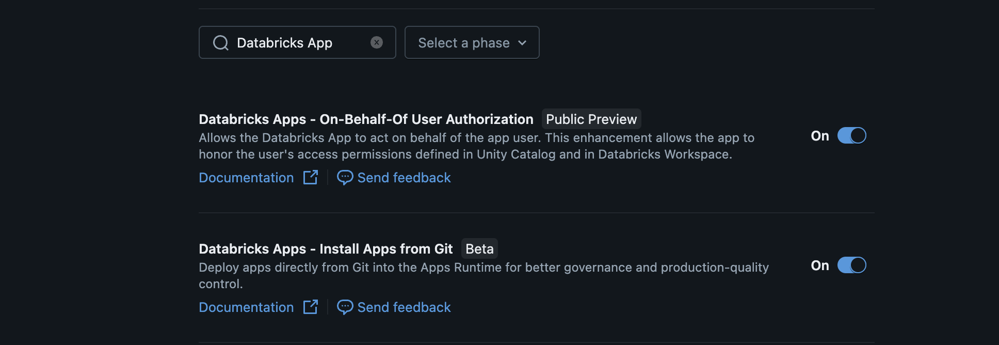

# Databricks Forge

> **IMPORTANT: This is NOT a Databricks product.** This project was built by the Databricks Field Engineering team as a field accelerator. It is provided "as-is" subject to the [Databricks License](LICENSE) with no warranty and no official support. See [NOTICE](NOTICE) for support policy.

**Transform your Unity Catalog metadata into actionable, AI-generated use cases.**

Databricks Forge is a web application deployed as a [Databricks App](https://docs.databricks.com/en/dev-tools/databricks-apps/index.html). Point it at your catalogs and schemas, and it uses LLM-powered analysis (via Databricks Model Serving) to discover, score, and export data-driven use cases -- without ever reading your actual data.

<p align="center">
  
</p>

---

## Deployment (Databricks Apps)

The supported deployment path is the included `deploy.sh` script. It keeps resource bindings, auth mode, and Lakebase secret rotation behavior consistent and auditable.

### Prerequisites

- [ ] **A Databricks workspace** with Unity Catalog enabled
- [ ] **A SQL Warehouse** (Serverless or Pro) running in that workspace
- [ ] **[Databricks CLI](https://docs.databricks.com/dev-tools/cli/install.html)** installed and authenticated
- [ ] **Workspace previews enabled**: **Databricks Apps - On-Behalf-Of User Authorization** must be turned on in your workspace Admin Settings under Previews (optional but recommended)

> **Lakebase is auto-provisioned.** The app creates its own Lakebase Autoscale project on first boot -- no manual database setup, no secret scopes, no resource bindings for the database.

<p align="center">
  
</p>

### Step 1: Deploy

```bash
git clone https://github.com/databricks-solutions/databricks-forge.git
cd databricks-forge
./deploy.sh
```

Lakebase is auto-provisioned by default — no flags required. Common
variations:

```bash
# Deploy a separate demo instance (isolated app + auto-provisioned database)
./deploy.sh --app-name "forge-demo"

# Bind an existing Lakebase project instead of auto-provisioning
./deploy.sh \
  --lakebase-branch   "projects/my-project/branches/production" \
  --lakebase-database "projects/my-project/branches/production/databases/databricks_postgres"

# Latency-critical deploy: disable scale-to-zero (keeps the DB warm)
./deploy.sh --lakebase-scale-to-zero-seconds 0
```

The deploy script discovers your SQL Warehouses, lets you pick one, creates
the app, uploads the code, and deploys. The premium model defaults to
`databricks-claude-opus-4-7` and the fast model to `databricks-claude-sonnet-4-6`.
The whole process takes 3-5 minutes.

### Step 2: Deploy completes

The script configures everything automatically -- resource bindings (SQL
warehouse, serving endpoints) and user authorization scopes (`sql`,
`catalog.tables:read`, `catalog.schemas:read`, `catalog.catalogs:read`,
`files.files`). No manual UI steps needed.

The platform will:

1. **Install dependencies** -- runs `npm install`
2. **Build** -- runs `npm run build` (generates Prisma client, builds the Next.js standalone server, copies static assets)
3. **Inject** environment variables from resource bindings
4. **Start** the app using `scripts/start.sh` (from `app.yaml`), which:
   - **Auto-provisions Lakebase** on first deploy (skipped on subsequent deploys)
   - Runs `prisma db push` (creates all tables on first deploy, applies additive changes on subsequent deploys)
   - Starts the Next.js standalone server on port 8000

> First deploy takes 3-5 minutes. Subsequent deploys are faster.

### Step 3: Verify

Open the app URL in your browser. You should see the Forge dashboard.

You can also check the health endpoint:

```bash
APP_URL=$(databricks apps get databricks-forge --output json | jq -r '.url')
curl -s "$APP_URL/api/health" | jq .
```

A healthy response:

```json
{
  "status": "healthy",
  "warehouse": "connected",
  "database": "connected"
}
```

---

### Updating the app

Pull the latest changes and re-run `./deploy.sh`. The script detects the existing app and updates it. Schema changes in `prisma/schema.prisma` are applied automatically on the next startup.

---

### Local Development (No Serverless Egress)

For environments that restrict serverless egress, or to test locally before
deploying, Forge can run on your machine pointing at a remote workspace.

> **New to Node.js?** Install Node 20+ from https://nodejs.org first. Verify
> with `node -v` and `npm -v`.

```bash
npm install                                                        # Install dependencies (~60s first time)
databricks auth login --host https://your-workspace.cloud.databricks.com  # One-time OAuth login
bash .deploy_local.sh                                              # Provisions Lakebase, selects warehouse, writes .env.local
npm run dev                                                        # Start dev server at http://localhost:3000
```

The first page load takes 10-15 seconds while Next.js compiles. You should
see the Forge dashboard. No PAT or long-lived credentials are stored on disk
-- the app authenticates via the Databricks CLI's OAuth session.

#### Multi-user testing locally (per-user isolation)

Forge enforces per-user isolation on every list, detail, update, delete, and
vector-search call. Two flags make local development frictionless:

- **`FORGE_LOCAL_USER_EMAIL`** -- the default identity used when no
  `x-forwarded-email` header is present. `.deploy_local.sh` writes this from
  your `$USER_EMAIL` automatically. Set it manually if you start the dev
  server yourself: `export FORGE_LOCAL_USER_EMAIL=alice@x.com`.

- **`?as_user=alice@x.com`** -- a request-scoped override gated to
  `NODE_ENV !== "production"`. Lets a single dev tab swap identities without
  restarting the server. Useful for end-to-end isolation testing:
  `http://localhost:3000/runs?as_user=bob@x.com`.

See [QUICKSTART.md](QUICKSTART.md) or [docs/DEPLOYMENT.md](docs/DEPLOYMENT.md)
for full details and troubleshooting.

---

### Environment variables at runtime

| Variable | Source | How it's set |
| --- | --- | --- |
| `DATABRICKS_HOST` | Workspace URL | Auto-injected by platform |
| `DATABRICKS_CLIENT_ID` | Service principal OAuth client ID | Auto-injected by platform |
| `DATABRICKS_CLIENT_SECRET` | Service principal OAuth client secret | Auto-injected by platform |
| `DATABRICKS_WAREHOUSE_ID` | SQL Warehouse ID | Set by `deploy.sh` in `app.yaml` |
| `DATABRICKS_SERVING_ENDPOINT` | Premium Model Serving endpoint name | Set by `deploy.sh` (default: `databricks-claude-opus-4-7`) |
| `DATABRICKS_SERVING_ENDPOINT_FAST` | Fast Model Serving endpoint name | Set by `deploy.sh` (default: `databricks-claude-sonnet-4-6`) |
| `DATABRICKS_EMBEDDING_ENDPOINT` | Embedding Model Serving endpoint name | Set by `deploy.sh` (default: `databricks-qwen3-embedding-0-6b`) |
| `PGHOST` / `PGUSER` / `PGDATABASE` / `PGPORT` / `PGSSLMODE` | Lakebase connection metadata | Auto-injected by the platform from the `postgres` resource binding |
| `LAKEBASE_ENDPOINT` | Lakebase endpoint resource path (`projects/.../branches/.../endpoints/...`) | Set by `deploy.sh` in `app.yaml` |
| `LAKEBASE_BOOTSTRAP_USER` | Optional Databricks user granted the same Postgres role as the SP | Set by `deploy.sh` (defaults to the deploying user when auto-provisioning) |
| `DATABASE_URL` | Lakebase connection string | Local development fallback only (production mints a fresh OAuth credential per process) |

> `DATABRICKS_HOST`, `DATABRICKS_CLIENT_ID`, and `DATABRICKS_CLIENT_SECRET` are injected automatically. The app authenticates to Lakebase via short-lived OAuth credentials minted from the app's service principal — no long-lived passwords are stored on disk.

### Auth model

The app uses **two complementary auth models** ([docs](https://docs.databricks.com/aws/en/dev-tools/databricks-apps/auth)):

**User authorization (OBO)** -- the logged-in user's identity and UC permissions:

| API | Scope | What runs as the user |
| --- | --- | --- |
| SQL Statement Execution | `sql` | All metadata queries, generated SQL, health check |
| Workspace REST API | -- | Notebook export runs as the app service principal (see below) |
| Unity Catalog metadata | `catalog.catalogs:read`, `catalog.schemas:read`, `catalog.tables:read` | `SHOW CATALOGS/SCHEMAS/TABLES`, `information_schema` |

**App authorization (service principal)** -- the app's own identity for background operations:

| Resource | Permission | What runs as the SP |
| --- | --- | --- |
| SQL Warehouse | **Can use** | Background pipeline tasks |
| Model Serving endpoint (premium) | **Can query** | Use case generation, scoring, SQL generation |
| Model Serving endpoint (fast) | **Can query** | Business context, table filtering, domain clustering, deduplication |
| Model Serving endpoint (embedding) | **Can query** | Embedding generation for semantic search |
| Workspace REST API | **Can manage** | Notebook export (mkdirs + import to `/Shared/forge_gen/`) |
| Unity Catalog | **USE CATALOG / USE SCHEMA / SELECT** | Background metadata queries |
| `system.access.table_lineage` | **SELECT** | Lineage graph walking |
| Genie Spaces | **Can manage** | Create, update, and trash Genie Spaces |

### Troubleshooting

| Symptom | Cause | Fix |
| --- | --- | --- |
| "DATABASE_URL is not set and Lakebase auto-provisioning is not available" | Running locally without `.env` | Set `DATABASE_URL` in `.env` for local dev |
| "Lakebase provisioning returned empty URL" | SP lacks permission to create Lakebase projects | Ensure the app's service principal can manage Lakebase resources |
| "Create project failed (403)" | Lakebase Autoscale not available in region | Check [supported regions](https://docs.databricks.com/aws/en/oltp/projects/authentication); for local fallback use a manual `DATABASE_URL` |
| `prisma db push` fails with "permission denied for schema public" | App SP was not granted `CREATE` on `public` (only happens on legacy deploys predating auto-grant bootstrap) | Re-run `./deploy.sh` from a workspace user who owns the Lakebase project — the SP grant bootstrap step will fix it |
| Schema push fails at startup | Lakebase compute still waking from scale-to-zero | Restart the app -- compute wakes automatically and retries succeed |
| "Failed to connect to warehouse" | Warehouse binding missing or stopped | Verify `sql-warehouse` resource is configured and warehouse is running |
| "Model serving request failed" | Serving endpoint binding missing | Verify `serving-endpoint` resource is configured. If fast tasks fail, check `serving-endpoint-fast` or remove it to fall back to premium |
| Semantic search returns no results | Embeddings not yet generated | Run an estate scan or pipeline; embeddings are generated automatically after each scan/run |
| "USE CATALOG denied" on discovery | User lacks UC grants | The logged-in user needs `USE CATALOG` / `USE SCHEMA` / `SELECT` on the catalogs they want to discover |
| Lineage discovery returns 0 tables | Missing lineage permissions | Grant `SELECT` on `system.access.table_lineage` to the user |

View logs:

```bash
databricks apps logs databricks-forge --follow
```

### Deployment checklist

```
[ ] 1. Databricks CLI installed and authenticated
[ ] 2. ./deploy.sh completed (creates app, binds resources, sets scopes, deploys)
[ ] 3. Health check passes: <app-url>/api/health
```

> Lakebase is auto-provisioned on first deploy -- no manual database setup needed.
> Resources (warehouse, endpoints) and user scopes are configured automatically by deploy.sh.

---

## What It Does

1. **Configure** -- enter your business name, select Unity Catalog scope, choose your industry, and set priorities.
2. **Discover** -- a 10-step AI pipeline extracts metadata, generates use cases, clusters them into business domains, scores them, generates runnable SQL, quantifies business value, and produces Genie Space recommendations. See [FORGE_ANALYSIS.md](FORGE_ANALYSIS.md) for the full breakdown.
3. **Analyse** -- review scored use cases, explore business value estimates, implementation roadmap, stakeholder mapping, and executive synthesis.
4. **Activate** -- deploy Genie Spaces, AI/BI dashboards, SQL notebooks, and AI catalog comments. Export results as Excel, PowerPoint, PDF, or portfolio deliverables.
5. **Track** -- follow use cases from discovery through delivery to measured business value, with voting, stalled alerts, and value capture.

### Key Features

- Discovers both **AI** use cases (ai_forecast, ai_classify, ai_query, etc.) and **Statistical** use cases (anomaly detection, trend analysis, geospatial, etc.)
- Scores every use case on **priority**, **feasibility**, **impact**, and **overall value**
- Automatically clusters use cases into **business domains and subdomains**
- **Business Value Intelligence** -- financial quantification (dollar-range estimates), roadmap phasing, executive synthesis, and stakeholder analysis
- **Genie Space generation** -- multi-pass engine producing column intelligence, semantic SQL, trusted queries, benchmarks, and metric view proposals
- **Genie Space health checks** -- deterministic scoring, automated fix workflow, and benchmark feedback loop for continuous improvement
- **AI/BI dashboards** -- auto-generated Lakeview dashboard recommendations per domain
- **AI catalog comments** -- industry-aware table and column descriptions with bulk apply/undo
- **Ask Forge** -- RAG-powered conversational assistant with SQL proposals, dashboard actions, and Genie Space deployment
- **Data estate intelligence** -- environment scanning with health scoring, lineage, ERD, governance gap analysis
- **Industry benchmarks** -- 562 reference use cases across 11 industries grounding LLM outputs in real-world data
- **Knowledge Base** -- upload strategy packs, data dictionaries, and governance policies to enrich AI context
- **Fabric / Power BI migration** -- scan PBI workspaces, propose gold schema DDL, translate DAX to SQL
- Deduplicates and ranks results so the highest-value opportunities surface first
- **Multi-language UI and AI output** -- the application UI is internationalised via `next-intl` (English, Português Brasil, Español), and the **AI Comment Language** setting controls the natural language of AI-generated table/column descriptions and use case fields (name, statement, solution, business value, beneficiary, sponsor, technical design) in both the AI Comments page and the New Discovery pipeline
- **Real-time status messages** during pipeline execution (e.g. "Filtering tables (batch 2 of 5)...")
- **Privacy-first**: reads only metadata by default (table/column names and schemas). Optional [data sampling](FORGE_ANALYSIS.md#data-sampling) can be enabled for improved SQL accuracy

---

## Tech Stack

| Layer | Technology |
| --- | --- |
| Frontend | Next.js 16 (App Router), React 19, shadcn/ui, Tailwind CSS 4 |
| Language | TypeScript (strict) |
| SQL Execution | Databricks SQL Statement Execution API via SQL Warehouse |
| LLM | Databricks Model Serving REST API (OpenAI-compatible chat completions) |
| Persistence | [Lakebase Autoscaling](https://docs.databricks.com/aws/en/oltp/projects/authentication) (Postgres-compatible) via Prisma ORM |
| Deployment | Databricks Apps (automatic OAuth, resource bindings) |
| Export | exceljs, pptxgenjs, Workspace REST API |

---

## Pipeline Steps

The "Discover Usecases" pipeline runs 10 steps. The frontend polls for progress in real time.

| Step | Name | What it does | Progress |
| --- | --- | --- | --- |
| 1 | **Business Context** | Generates strategic goals, value chain, and revenue model via Model Serving | 10% |
| 2 | **Metadata Extraction** | Queries `information_schema` for tables, columns, foreign keys, and metric views | 18% |
| 3 | **Asset Discovery** | Discovers existing Genie Spaces, dashboards, and metric views in scope (optional) | 22% |
| 4 | **Table Filtering** | Classifies tables as business-relevant vs technical via Model Serving (JSON mode) | 30% |
| 5 | **Use Case Generation** | Generates AI and statistical use cases in parallel batches via Model Serving (JSON mode) | 45% |
| 6 | **Domain Clustering** | Assigns domains and subdomains via Model Serving, merges small domains | 55% |
| 7 | **Scoring & Dedup** | Scores on priority/feasibility/impact, removes duplicates via Model Serving | 65% |
| 8 | **SQL Generation** | Generates runnable Databricks SQL per use case via Model Serving (streaming) | 80% |
| 9 | **Business Value Analysis** | Financial quantification, roadmap phasing, executive synthesis, stakeholder analysis | 90% |
| 10 | **Genie Recommendations** | Multi-pass Genie Space generation with benchmarks and metric view proposals (background) | 100% |

The Dashboard Engine also runs in the background alongside step 10, producing AI/BI dashboard recommendations per domain.

Each step updates its status and a human-readable **status message** in Lakebase (e.g. "Scanning catalog main...", "Scoring domain: Customer Analytics (14 use cases)..."). The frontend polls every 3 seconds and displays the latest message alongside the progress stepper.

> For the full analysis methodology, scoring formulas, prompt engineering details, and data flow diagrams, see [FORGE_ANALYSIS.md](FORGE_ANALYSIS.md).

---

## Lakebase (Zero-Touch Auto-Provisioning)

The app persists all state (pipeline runs, use cases, exports) in [Lakebase Autoscaling](https://docs.databricks.com/aws/en/oltp/projects/authentication) -- a Postgres-compatible OLTP database managed by Databricks. The schema is managed by [Prisma ORM](https://www.prisma.io/).

### How it works

**No manual database setup is required.** `./deploy.sh`:

1. **Auto-provisions a per-app Lakebase project** (named after `--app-name`, e.g. `databricks-forge`) — creates the project, default branch, and `databricks_postgres` database.
2. **Re-uses the existing binding** on subsequent deploys (keyed by `--app-name`) — no duplicate projects.
3. **Installs `pgvector` and `databricks_auth`** as the project owner before the app starts.
4. **Grants the app's service principal** `CONNECT` + `USAGE`/`CREATE` on `public` + table/sequence privileges + default privileges so `prisma db push` succeeds on first boot.
5. **Transfers ownership** of any pre-existing `public.*` tables to the SP so Prisma can `ALTER`/`DROP` them on schema migrations.
6. **Configures scale-to-zero** (`300s` default; override with `--lakebase-scale-to-zero-seconds`).
7. **Grants the deploying user** the same Postgres role as the SP by default, so they can open the SQL Editor against their new database immediately. Opt out with `--lakebase-bootstrap-user ""`.

Advanced overrides (rarely needed):

- `--lakebase-project-id ID` — override the auto-derived project ID.
- `--lakebase-branch / --lakebase-database` — bind an existing, externally-managed project/branch/database instead of auto-provisioning.
- `--lakebase-scale-to-zero-seconds N` — branch inactivity timeout (`0` = always-on).
- `--lakebase-bootstrap-user EMAIL` — grant another Databricks user SQL Editor access.

### First deploy vs subsequent deploys

| Scenario | What happens | Extra time |
| --- | --- | --- |
| **First deploy** | Creates Lakebase project, waits for it to be ready, creates all tables | ~30-60s |
| **Subsequent deploys** | Detects existing project, skips creation, syncs schema (no-op if unchanged) | ~1-2s |
| **After idle (scale-to-zero)** | Compute wakes automatically on first connection | ~200ms |

### Redeployments are safe

`prisma db push` is idempotent: if the tables already exist and match the schema, it does nothing. If new tables or columns were added to the Prisma schema, it creates them. It never drops existing tables or columns.

---

## Export Formats

### Per-Run Exports

| Format | Library | What you get |
| --- | --- | --- |
| **Excel** | exceljs | Multi-sheet workbook: Summary, Use Cases, Domains, Business Value, Stakeholders |
| **PowerPoint** | pptxgenjs | Executive deck with optional synthesis slides (findings, recommendations, risks, value summary) |
| **PDF** | pdfkit | Databricks-branded A4 landscape report with cover page, executive summary, domains, and use cases |
| **Notebooks** | Workspace REST API | One SQL notebook per domain, deployed to `/Shared/forge_gen/` via the app service principal |

### Portfolio Exports (cross-run)

| Format | What you get |
| --- | --- |
| **Portfolio Excel** | 8-sheet workbook: Executive Summary, Key Findings, Recommendations, Risk Callouts, Domain Performance, Delivery Pipeline, Use Cases with ROI, Stakeholders |
| **Portfolio PowerPoint** | 8-slide Databricks-branded deck with KPIs, findings, recommendations, and delivery roadmap |
| **Executive PDF** | 2-page brief: KPIs, key findings, recommendations, pipeline, domain heatmap, and risks |
| **D4B Workshop Pack** | 5-section workshop deck: Case for Change, Executive Findings, Delivery Roadmap, Recommended Genie Spaces, Workshop Agenda |

---

## Configuration Options

These map to the form fields on the `/configure` page:

| Field | Required | Default | Description |
| --- | --- | --- | --- |
| **Business Name** | Yes | -- | Organisation or project name |
| **UC Metadata** | Yes | -- | Unity Catalog scope: `catalog`, `catalog.schema`, or comma-separated list |
| **Business Priorities** | No | Increase Revenue | Multi-select from 10 predefined priorities |
| **Strategic Goals** | No | Auto-generated | Custom goals for scoring alignment |
| **Business Domains** | No | Auto-detected | Focus domains (e.g. "Risk, Finance, Marketing") |
| **AI Model** | No | databricks-claude-opus-4-7 | Model Serving endpoint for LLM calls (chat completions) |
| **AI Comment Language** | No | English | Natural language used by AI-generated table/column comments and use case fields. Configured in **Settings → AI** (`English`, `Português (Brasil)`, `Español`). Technical identifiers (FQNs, function names) always stay in English. |

### Cost governance (optional)

Both options below are optional and independent. Leave them unset to keep the current behaviour.

```bash
# Attach a serverless budget policy to the Databricks App and the
# Lakebase project for cost attribution.
./deploy.sh --budget-policy-id "<policy-id>"

# Tag the Lakebase project (repeatable). The Databricks Apps API does
# not accept tags on the App resource, so these tags apply only to the
# Lakebase project. On redeploys the tags are reconciled via PATCH.
./deploy.sh --tag team=data-eng --tag cost-center=1234

# Both flags can be combined.
./deploy.sh --budget-policy-id "<policy-id>" --tag env=prod
```

**Default tags.** Passing `--tag` at least once opts in to tag management. In that case, two default tags are injected unless overridden with `--tag <same-key>=<value>`:

| Key | Value |
| --- | --- |
| `project` | `databricks_forge` |
| `owner` | email of the user running the deploy (skipped when unresolvable) |

When `--tag` is not passed, no tags are applied and existing tags on the Lakebase project are left untouched (neither the create spec nor the reconcile PATCH fires).

- **First deploy**: values are included in the initial `createProject` spec and the `apps create`/`apps update` calls.
- **Redeploys**: `deploy.sh` re-applies `budget_policy_id` on the App; on the Lakebase side, the app reconciles `spec.budget_policy_id` and `spec.custom_tags` via PATCH on the next boot (non-fatal on failure). Updating `custom_tags` fully replaces the existing list.

---

## Development

```bash
npm run dev        # Start development server (Turbopack)
npm run build      # Production build
npm run start      # Start production server
npm run lint       # Run ESLint
npm run typecheck  # TypeScript strict type checking
npm test           # Run tests (Vitest)
```

See [docs/ARCHITECTURE.md](docs/ARCHITECTURE.md) for the full system design, layer responsibilities, and data flow. See [docs/DEPLOYMENT.md](docs/DEPLOYMENT.md) for local development setup instructions.

---

## Privacy

By default, Forge reads **metadata only** -- schema names, table names, column names, data types, and comments. All LLM prompts contain only structural metadata.

When **Data Sampling** is enabled in Settings, the app reads a configurable number of rows (5-50) per table during SQL generation. Sampled data is sent to the AI model to improve SQL accuracy but is **not persisted** -- it exists only in memory during the generation step. See [FORGE_ANALYSIS.md - Privacy Model](FORGE_ANALYSIS.md#privacy-model) for the full breakdown.

---

## Further Documentation

| Document | Description |
| --- | --- |
| [WHY_FORGE.md](WHY_FORGE.md) | **Why Forge?** -- customer-facing value proposition and full feature overview |
| [docs/USER_GUIDE.md](docs/USER_GUIDE.md) | **User guide** -- step-by-step walkthrough of every feature with screenshots |
| [FORGE_ANALYSIS.md](FORGE_ANALYSIS.md) | **Comprehensive analysis guide** -- pipeline logic, scoring methodology, prompt engineering, data flow diagrams |
| [ESTATE_ANALYSIS.md](ESTATE_ANALYSIS.md) | **Estate scan guide** -- environment intelligence pipeline, health scoring, lineage |
| [ASK_FORGE.md](ASK_FORGE.md) | **Ask Forge** -- conversational assistant architecture, intent classification, RAG, actions |
| [docs/BUSINESS_VALUE.md](docs/BUSINESS_VALUE.md) | **Business Value Engine** -- financial quantification, roadmap, stakeholders, exports |
| [docs/ENGINES.md](docs/ENGINES.md) | **Engines overview** -- architecture, catalog, shared patterns, and how engines connect |
| [docs/GENIE_ENGINE.md](docs/GENIE_ENGINE.md) | **Genie Engine** -- multi-pass Genie Space generator architecture and best practices |
| [docs/GENIE_HEALTHCHECK_ENGINE.md](docs/GENIE_HEALTHCHECK_ENGINE.md) | **Genie Health Check Engine** -- deterministic scoring, fix workflow, benchmark feedback |
| [docs/DASHBOARD_ENGINE.md](docs/DASHBOARD_ENGINE.md) | **Dashboard Engine** -- AI/BI dashboard recommendation generator |
| [docs/COMMENT_ENGINE.md](docs/COMMENT_ENGINE.md) | **Comment Engine** -- AI catalog comment generation |
| [docs/SQL_ENGINE.md](docs/SQL_ENGINE.md) | **SQL Engine** -- grounded SQL generation and validation across all surfaces |
| [docs/METRIC_VIEW_ENGINE.md](docs/METRIC_VIEW_ENGINE.md) | **Metric View Engine** -- metric view generation, validation, and deployment |
| [docs/SKILLS_KNOWLEDGE_BASE.md](docs/SKILLS_KNOWLEDGE_BASE.md) | **Skills and Knowledge Base** -- composable domain knowledge and document RAG |
| [docs/PIPELINE.md](docs/PIPELINE.md) | Pipeline step reference |
| [docs/BENCHMARKS.md](docs/BENCHMARKS.md) | Industry benchmarks catalog |
| [SECURITY_ARCHITECTURE.md](SECURITY_ARCHITECTURE.md) | **Security architecture** -- data flows, threat mitigations, auth model, compliance posture |
| [docs/ARCHITECTURE.md](docs/ARCHITECTURE.md) | System architecture and Lakebase schema |
| [docs/PROMPTS.md](docs/PROMPTS.md) | Prompt template catalog |
| [docs/DEPLOYMENT.md](docs/DEPLOYMENT.md) | Deployment and local dev guide |
| [CONTRIBUTING.md](CONTRIBUTING.md) | Contribution guidelines and development setup |
| [SECURITY.md](SECURITY.md) | Vulnerability reporting process |
| [CHANGELOG.md](CHANGELOG.md) | Release history |

---

## Disclaimer

**This project is NOT an official Databricks product, feature, or service.** It was developed by the Databricks Field Engineering team as an internal accelerator and is shared as-is for informational and experimental purposes.

- **Status**: Alpha -- incomplete, likely contains bugs, may change or be discontinued without notice
- **No warranty**: Provided "AS IS" without warranties of any kind
- **No support**: No official support, SLAs, or maintenance commitments from Databricks
- **No liability**: Databricks and its contributors accept no liability for any damages or consequences arising from use
- **Not reviewed**: This software has NOT been reviewed or approved by Databricks product, security, or legal teams for production use

**Use at your own risk.** You are solely responsible for evaluating fitness for your use case, testing, and ensuring compliance with your organisation's policies. See [NOTICE](NOTICE) for full details.

---

## License

Copyright 2024-2026 Databricks, Inc. Provided subject to the [Databricks License](LICENSE). See [NOTICE](NOTICE) for third-party attributions.
