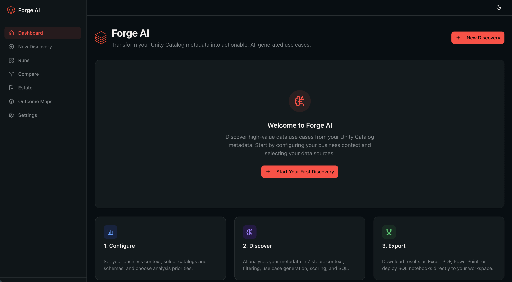

# Databricks Forge

> Databricks Forge is a community-maintained Databricks Field Engineering
> accelerator. It is not an official Databricks product and is not covered by
> Databricks Support. See [Support](SUPPORT.md) and [Notice](NOTICE).

Turn Unity Catalog metadata into a prioritized, financially grounded backlog
of data and AI opportunities, then activate recommendations as Genie Spaces,
AI/BI dashboards, metric views, SQL notebooks, and catalog documentation.

Forge runs as a [Databricks App](https://docs.databricks.com/aws/en/dev-tools/databricks-apps/).
Metadata is the default input. Optional row sampling is explicit, configurable,
and never persisted.

<p align="center">
  
</p>

## Deploy in five minutes

### Prerequisites

- A Databricks workspace with Unity Catalog
- A running Serverless or Pro SQL warehouse
- [Databricks CLI](https://docs.databricks.com/dev-tools/cli/install.html)
  0.205 or later, authenticated to the target workspace
- Node.js 20.9 or later and Python 3
- Permission to create Databricks Apps and Lakebase resources

```bash
git clone https://github.com/databricks-solutions/databricks-forge.git
cd databricks-forge
databricks auth login --host https://your-workspace.cloud.databricks.com
./deploy.sh
```

The script selects a warehouse, checks model availability, provisions an
isolated Lakebase project, binds resources, configures user authorization, and
deploys the app. It prints the app URL when deployment completes.

Continue with the [Quick Start](docs/quickstart.md) to verify health, complete
first-run setup, update Forge, or remove it safely.

## What Forge provides

- **Use-case discovery:** Generate, score, deduplicate, and rank analytics and
  AI opportunities from catalog metadata.
- **Business value:** Estimate financial impact, delivery phases, dependencies,
  stakeholders, and executive recommendations.
- **Genie Studio:** Create, assess, benchmark, and improve Databricks Genie
  Spaces.
- **AI/BI activation:** Generate validated dashboard, metric-view, SQL, and
  notebook recommendations.
- **Estate intelligence:** Analyze domains, lineage, health, maturity,
  governance gaps, and data-product opportunities.
- **Catalog documentation:** Generate and review table and column comments with
  bulk apply and undo.
- **Ask Forge:** Explore findings through a retrieval-grounded conversational
  assistant.
- **Executive exports:** Produce Excel, PowerPoint, PDF, and board-ready
  portfolio artifacts.

See the [User Guide](docs/USER_GUIDE.md) for the complete product walkthrough.

## Privacy and identity

Forge reads schema metadata such as catalog, schema, table, and column names,
types, and comments. When an operator explicitly enables data sampling, Forge
reads a limited number of rows to improve SQL accuracy; sampled rows are held
in memory and are not persisted.

Interactive Databricks operations use the signed-in user's on-behalf-of token
where required. Background operations use the Databricks App service principal
and explicit resource bindings. See
[Security Architecture](SECURITY_ARCHITECTURE.md) for data flows, permissions,
isolation, and threat mitigations.

## Technology

| Layer | Technology |
| --- | --- |
| Application | Next.js 16, React 19, TypeScript |
| UI | Tailwind CSS 4, shadcn/ui |
| SQL | Databricks SQL Statement Execution API |
| AI | Databricks Model Serving |
| Persistence | Lakebase Autoscaling with Prisma |
| Deployment | Databricks Apps |

## Start here

- [Quick Start](docs/quickstart.md)
- [Deployment and Operations](docs/DEPLOYMENT.md)
- [User Guide](docs/USER_GUIDE.md)
- [Architecture](docs/ARCHITECTURE.md)
- [Security Architecture](SECURITY_ARCHITECTURE.md)
- [Engine Reference](docs/ENGINES.md)
- [Support](SUPPORT.md)
- [Security Policy](SECURITY.md)
- [Contributing](CONTRIBUTING.md)
- [Changelog](CHANGELOG.md)

## Local development

Use Node.js 20.9 or later:

```bash
npm ci
databricks auth login --host https://your-workspace.cloud.databricks.com
bash .deploy_local.sh
npm run dev
```

The setup script provisions local Lakebase access, selects a warehouse, and
writes `.env.local`. It uses the Databricks CLI OAuth session; no personal
access token is required. See
[Deployment and Operations](docs/DEPLOYMENT.md#local-development) for details.

Before opening a pull request:

```bash
npm run check:public
npm run format:check
npm run lint
npm run typecheck
npm test
npm run test:quality
npm run build
```

## Support and license

Community support is best effort through
[GitHub Discussions](https://github.com/databricks-solutions/databricks-forge/discussions)
and [GitHub Issues](https://github.com/databricks-solutions/databricks-forge/issues).
Do not post vulnerabilities publicly; use
[private vulnerability reporting](https://github.com/databricks-solutions/databricks-forge/security/advisories/new).

Copyright 2024-2026 Databricks, Inc. Forge is provided under the
[Databricks License](LICENSE), without warranty. See [NOTICE](NOTICE).
